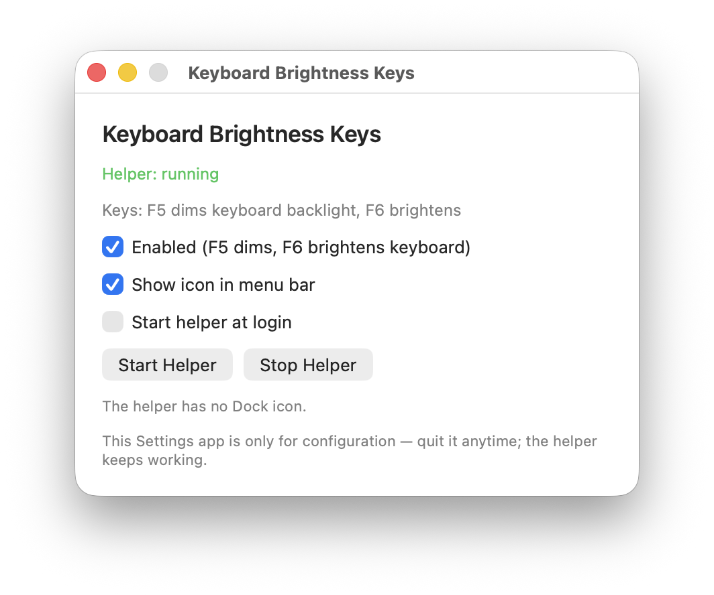

# Keyboard Brightness Keys

macOS utility that brings back **F5 / F6 keyboard backlight** control on modern MacBooks — without enabling “Use F1, F2, etc. keys as standard function keys.”

| Key                   | Action                      |
| --------------------- | --------------------------- |
| **F5**                | Dim keyboard backlight      |
| **F6**                | Brighten keyboard backlight |
| **fn**+F5 / **fn**+F6 | Normal F5 / F6              |

Other function keys (brightness, volume, media, etc.) are unchanged.



## Features

- Restores classic MacBook keyboard-backlight keys on F5 / F6
- Leaves the rest of the function row alone
- Optional menu bar icon
- Optional start-at-login for the background helper
- Settings app you can quit anytime — the helper keeps running

## Requirements

- macOS 14 or later
- Apple Silicon MacBook (built for `arm64`)

## Install

### Download (recommended)

1. Grab the latest zip from [Releases](https://github.com/Gtes/keyboard_brightness_keys/releases).
2. Unzip and move **Keyboard Brightness Keys.app** to Applications (or `~/Applications`).
3. Open it. If Gatekeeper blocks it, right-click the app → **Open**.

### Build from source

If you prefer to compile it yourself:

```bash
git clone https://github.com/Gtes/keyboard_brightness_keys.git
cd keyboard_brightness_keys
./build.sh
open ~/Applications/Keyboard\ Brightness\ Keys.app
```

This builds and installs:

- `~/Applications/Keyboard Brightness Keys.app` — Settings (Dock), with the background helper nested inside

## Usage

1. Open **Keyboard Brightness Keys**.
2. Keep **Enabled** checked.
3. Optionally enable **Show icon in menu bar** and **Start helper at login**.
4. Press **F5** / **F6** to adjust keyboard backlight.

Use **Start Helper** / **Stop Helper** if you need to restart the background process.

## How it works

On recent MacBook Pros, pressing F5 / F6 alone sends Dictation and Focus HID usages. The helper remaps those usages to keyboard illumination down / up with `hidutil`, the same backlight controls older MacBooks exposed on those keys.

## Project layout

```text
Sources/Shared/     config, HID remap, helper control
Sources/Helper/     background helper + menu bar icon
Sources/Settings/   settings UI
Resources/Icon.png  app + menu bar icon
build.sh            build & install the single nested app
```

## AI disclosure

This project’s code was generated with **Cursor (Composer)** and then reviewed, tested, and verified by a human. Treat it like any other third-party utility: skim the source before running it if that matters to you.

## License

Released under the [MIT License](LICENSE).

Copyright © 2026 SK ([@Gtes](https://github.com/Gtes))
